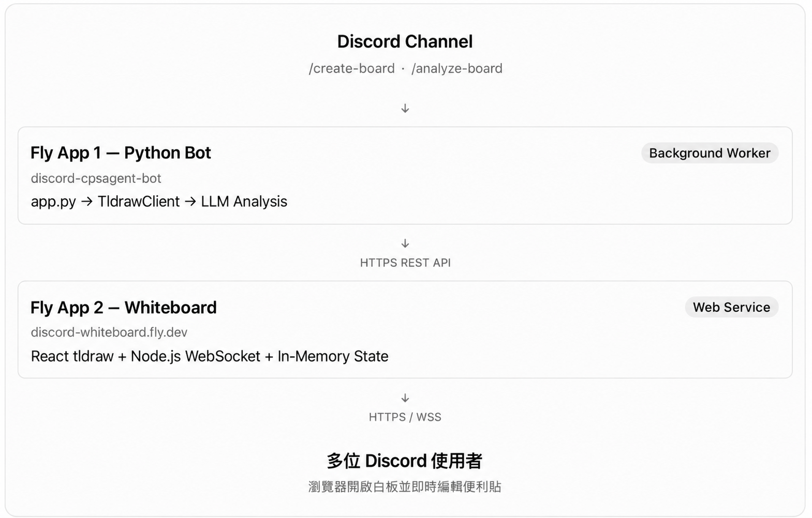
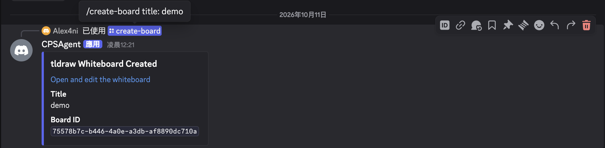
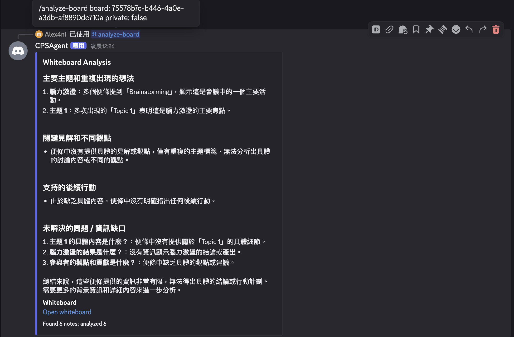
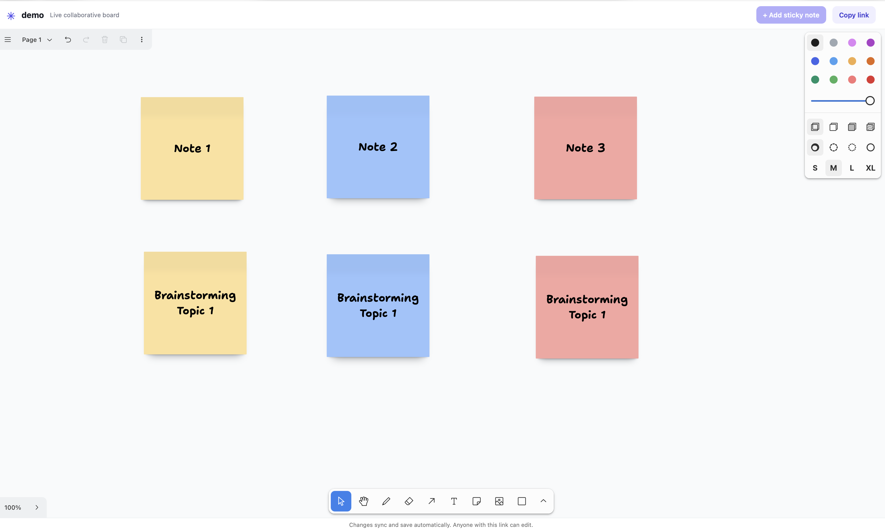

# Discord CPSAgent 
Discord CPSAgent is a collaborative brainstorming and discussion analysis tool developed for CPS (Collaborative Problem Solving) research.

The project integrates Discord, tldraw, and Fly.io to provide an interactive environment where users can collaborate on shared whiteboards, organize ideas using sticky notes, and generate AI-powered discussion summaries.

## 1. Technologies Used

### (1) Discord Chatbot

Discord serves as the main interface for user interaction and collaboration.

The chatbot is developed by Python, supporting Slash Commands to manage collaborative whiteboards and trigger AI analysis.

**Key Features:**
- `/create-board` — Create a new collaborative whiteboard and return its URL.
- `/analyze-board` — Retrieve sticky notes from a whiteboard and generate an AI-powered analysis.
- **Discussion Monitoring** — Analyze conversations and user participation within Discord channels.
- **AI-Powered Summarization** — Generate discussion summaries, identify key ideas, and suggest potential action items.

### (2) tldraw React Whiteboard SDK

[tldraw](https://tldraw.dev/) is a React-based whiteboard SDK that provides an interactive canvas for real-time collaboration.

It allows users to freely create, edit, and organize sticky notes on shared whiteboards.

**Key Features:**
- **Sticky Notes** — Create and organize ideas using editable notes.
- **Multi-User Collaboration** — Synchronize whiteboard changes in real time through WebSocket connections.
- **Structured Data Access** — Retrieve whiteboard content as structured JSON data for backend analysis.

### (3) Fly.io

[Fly.io](https://fly.io/) is a cloud application platform used to deploy and host the project's services.

The system uses two independent Fly.io applications:

| Application | Description |
|---|---|
| **Discord CPSAgent Bot** | Runs the Python Discord chatbot as a background worker, handling user commands and LLM analysis. |
| **tldraw Whiteboard** | Hosts the React frontend and Node.js backend, providing REST APIs and real-time WebSocket synchronization. |

**Key Features:**
- **Cloud Deployment** — Host application services independently.
- **HTTPS / WebSocket** — Support secure API communication and real-time collaboration.
- **Public Whiteboard Access** — Allow users to access collaborative whiteboards through shared URLs.
- **Independent Services** — Deploy and manage the Discord chatbot and whiteboard backend separately.

## 2. System Architecture

The system consists of three main components:

1. **Discord Bot (Python):** Handles Slash Commands, user interactions, and AI-powered analysis.
2. **Whiteboard Service (React + Node.js):** Provides the collaborative canvas, REST APIs, and WebSocket synchronization.
3. **Fly.io:** Hosts the Discord Bot and Whiteboard Service as separate cloud applications.

### Workflow

1. A user enters `/create-board` in a Discord channel.
2. The Discord Bot requests a new whiteboard through the backend REST API.
3. The user receives a whiteboard URL and shares it with other participants.
4. Multiple users collaborate by creating and editing sticky notes in real time.
5. A user enters `/analyze-board` to retrieve the current whiteboard content.
6. The backend passes the extracted sticky notes to an LLM for analysis.
7. The Discord Bot returns the analysis results to the channel.

## 3. Project Goals

This project aims to explore how AI-assisted tools can support **Collaborative Problem Solving (CPS)** by:

- Facilitating real-time idea sharing and group brainstorming.
- Collecting structured discussion content from collaborative whiteboards.
- Analyzing group discussions and identifying key insights.
- Evaluating participation and collaboration patterns.
- Supporting AI-assisted reflection and discussion summarization.

The project is designed as a research-oriented prototype for exploring AI-supported collaborative learning and problem-solving environments.
